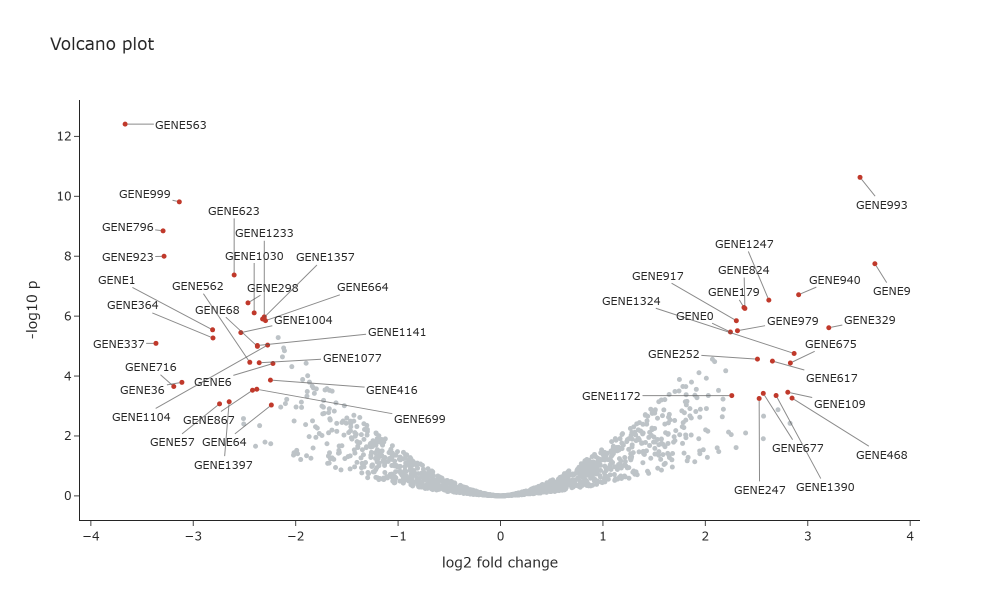

# repelly

[](https://pypi.org/project/repelly/)
[](https://pypi.org/project/repelly/)
[](https://github.com/m9o8/repelly/actions/workflows/ci.yml)
[](https://github.com/m9o8/repelly/blob/main/LICENSE)

**Repelling, non-overlapping text labels for Plotly in Python**, in the spirit of R's
[ggrepel](https://ggrepel.slowkow.com/).



## Features

- Labels are solved in the browser and re-solved on zoom, pan, resize and animation.
- Labels stay clear of each other and of every marker in the subplot.
- They are native Plotly annotations, so they appear in the modebar's PNG download.
- Works with `plotly.express`, including facets, animations and `scattergl`.
- Supports linear, log, date, category and reversed axes.
- Runs in HTML files, the browser, notebooks and Dash, and exports to static images.

## Installation

```bash
pip install repelly
```

Optional extras add static image export and Dash:

```bash
pip install "repelly[static]"
pip install "repelly[dash]"
```

Requires Python 3.10+ and Plotly 6.2+.

## Quick start

```python
import pandas as pd
import plotly.express as px
from repelly import add_text_repel

df = pd.DataFrame(
    {
        "x": [1, 1.05, 1.02, 0.98, 1.5, 2.0],
        "y": [2, 2.02, 2.05, 1.97, 2.5, 3.0],
        "gene": ["TP53", "EGFR", "MYC", "PTEN", "BRCA1", "KRAS"],
    }
)

fig = px.scatter(df, x="x", y="y")
fig = add_text_repel(fig, df.x, df.y, df.gene)
fig.show()
```

`add_text_repel` returns a copy of your figure as a `RepelFigure`, so keep the returned
value. It is a `go.Figure` whose `show`, `to_html`, `write_html`, `to_image` and
`write_image` methods include the labels. `plotly.io.show(fig)` bypasses them, so call
the figure's own methods. If an operation hands back a plain `go.Figure`,
`as_repel_figure(fig)` restores it.

## Usage

### Boxed labels

`add_label_repel` takes the same arguments and draws each label on a filled box:

```python
from repelly import add_label_repel

fig = add_label_repel(fig, df.x, df.y, df.gene, label={"bgcolor": "lightyellow"})
```

### Labelling existing traces

Omit `x` and `y` to label the points of scatter traces already in the figure. This is the
simplest route for facets and animations. Labels hide when their trace is hidden from the
legend, and each animation frame gets its own labels.

```python
fig = px.scatter(df, x="gdpPercap", y="lifeExp", facet_col="continent", text="country")
fig.update_traces(mode="markers")  # repelly draws the text
fig = add_text_repel(fig)

fig = px.scatter(df, x="x", y="y", custom_data=["name"])
fig = add_text_repel(fig, text=lambda trace: trace.customdata[:, 0])
```

`text` defaults to each trace's `text`, then `hovertext`. Narrow the traces with
`selector`, `row` and `col`.

### Subplots

For explicit coordinates, choose the subplot with `row` and `col`, or `xref` and `yref`:

```python
fig = add_text_repel(fig, x, y, names, row=1, col=2)
```

### Dash

Call `init_app` once. Figures then work as normal, including as callback outputs:

```python
from dash import Dash, dcc
import repelly.dash

app = Dash(__name__)
repelly.dash.init_app(app)
app.layout = dcc.Graph(figure=fig)
```

Each solve updates the graph's layout, so a callback listening to `relayoutData` also
fires when labels are placed.

### Notebooks

**JupyterLab** uses its built-in Plotly, so charts work offline and add little to the
notebook. When you reopen a saved notebook, JupyterLab shows a saved preview without
labels until you hover over the chart.

**VS Code needs internet access for notebook charts.** It does not let scripts reach its
built-in Plotly, so repelly shows each chart in an iframe that loads Plotly from a CDN.
Offline, the chart shows a message instead. To work offline anyway, call
`fig.show(include_plotlyjs=True)`, which embeds about 5 MB in each output. HTML files,
browser output, Dash and static images all work offline in VS Code as usual.

### Static images

`fig.write_image(...)` and `fig.to_image(...)` solve the labels in headless Chrome, using
Kaleido's browser or any installed Chrome, Chromium or Edge (set `BROWSER_PATH` to choose
one). Positions are computed for the export size.

`repelly.bake(fig, width=..., height=...)` returns a plain figure with the positions
fixed, if you need one to pass elsewhere.

## Options

| Argument | Default | Purpose |
| --- | --- | --- |
| `row`, `col`, `secondary_y`, `xref`, `yref` | primary axes | Target subplot for explicit `x` and `y` |
| `selector` | all traces | Which traces to label when `x` and `y` are omitted |
| `priority` | none | Higher values survive culling first |
| `visible` | all | Boolean mask; hidden points still repel other labels |
| `frame` | none | Animation frame name per label, for explicit `x` and `y` |
| `force` | `1.0` | Separation strength, effective range 0.05 to 1 |
| `force_pull` | `1.0` | Pull back towards the anchor |
| `box_padding`, `point_padding` | `2`, `2` | Gaps in pixels |
| `direction` | `"both"` | Restrict movement to `"x"` or `"y"`; one value or one per label |
| `color` | font colour | Text colour; one value, one per label, or `"trace"` to match each point when labelling traces |
| `nudge_x`, `nudge_y` | `0` | Preferred offset from the point in pixels, positive right and up; one value or one per label |
| `xlim`, `ylim` | plot area | `(low, high)` data values labels must stay within; `None` leaves a side open |
| `max_overlaps` | `10` | Drop a label starting on more than this many higher-priority labels; `None` keeps all |
| `max_labels` | none | Maximum labels per subplot from this call, by priority |
| `max_iter`, `max_time_ms` | `400`, `40` | Solver limits for one solve; time in milliseconds |
| `initial_max_time_ms` | `250` | Time limit when labels are first placed; the solver stops sooner if it finishes |
| `seed` | `42` | Makes placement reproducible |
| `min_segment_length` | `6` | Hide the connector below this distance in pixels |
| `avoid_points` | `True` | Keep labels off every marker in the subplot |
| `drop_unresolved` | `False` | Hide labels that still overlap after solving |
| `font`, `segment` | Plotly defaults | Styling; `segment` takes `color`, `width`, `arrowhead`, `arrowsize` |
| `on` | all events | Re-solve on any of `"zoom"`, `"resize"`, `"frame"`; the first render always solves |

## Diagnostics

Labels that are hidden by `max_overlaps`, or that still overlap another label or cover a
data point after solving, are reported with a warning in the browser console. `bake`, `to_image` and `write_image`
raise the same information as a Python warning.

## Limitations

- Only cartesian `scatter` and `scattergl` traces can be labelled from traces.
- `FigureWidget` is not supported.
- Configuration lives in `layout.meta`, so that must be unset or a dict. Replacing it
  afterwards removes the labels.
- Solving freezes autoranged axes at their current range, because annotations would
  otherwise change the range they were placed in. Double-click still resets the view.

## Development

The project uses [pixi](https://pixi.sh). Browser tests need Chrome or Edge installed.

```bash
pixi install
pixi run hooks      # format and lint before each commit
pixi run lint       # ruff format and ruff check --fix
pixi run test-all   # Python and JavaScript tests
pixi run -e min test-all   # against the oldest supported dependencies
pixi run check-dist # build and validate the package
```

If the commit hook reformats files, stage them and commit again.

To release, update `__version__` in `src/repelly/__init__.py` and the matching `VERSION`
in `src/repelly/js/runtime.js`, then publish a GitHub release tagged `vX.Y.Z`.

## Acknowledgements

repelly brings the ideas of two R packages to Python:

- [ggrepel](https://github.com/slowkow/ggrepel) by Kamil Slowikowski and contributors,
  the original repelling-label package.
- [plotly.repel](https://github.com/bigomics/plotly.repel) by Santiago Cano Muniz, which
  pioneered browser-side solving for Plotly and the `add_text_repel` interface.

See [NOTICE](https://github.com/m9o8/repelly/blob/main/NOTICE) for full credits.

## License

Copyright (C) 2026 Moritz Peist. Licensed under the
[GNU General Public License, version 3 or later](https://github.com/m9o8/repelly/blob/main/LICENSE).

Interactive output embeds repelly's GPL-licensed JavaScript, so HTML files and Dash pages
you distribute contain GPL code. The script keeps its license notice for this purpose.
Static images and baked figures do not contain it.
